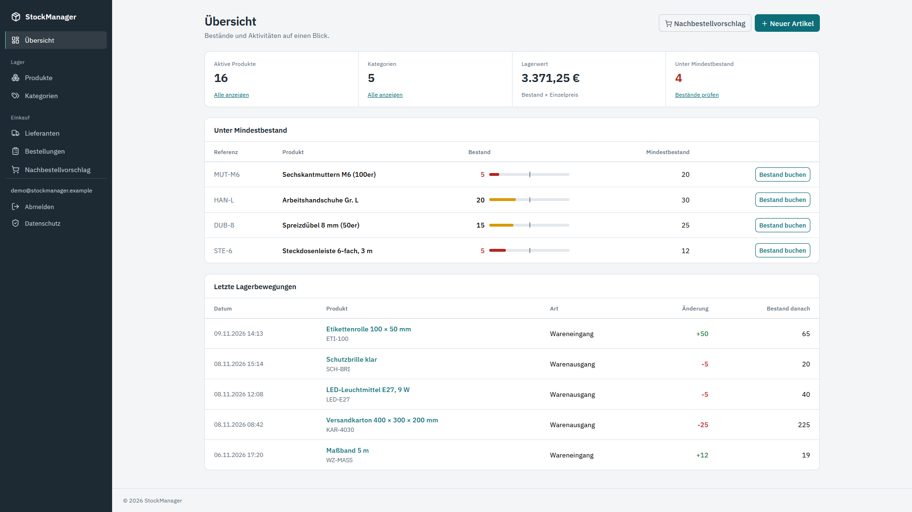
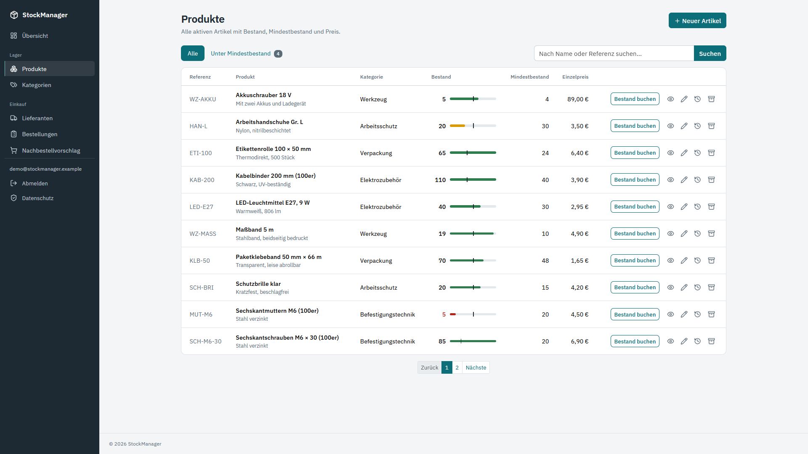
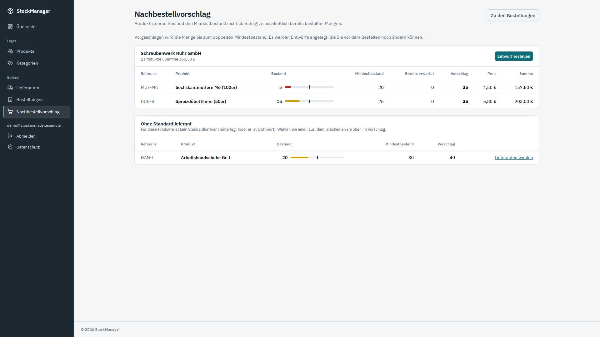
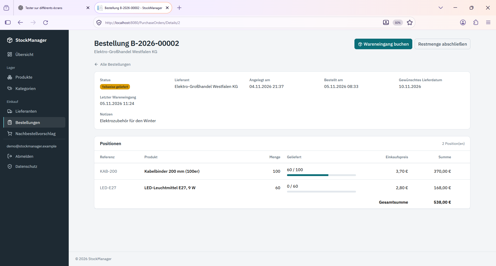
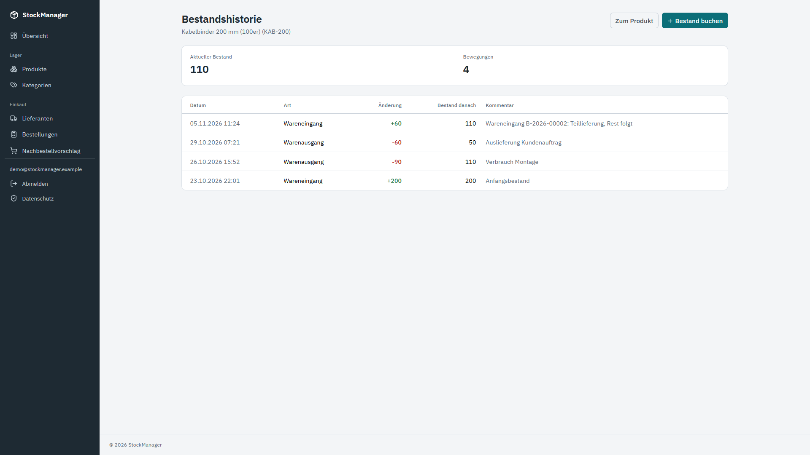
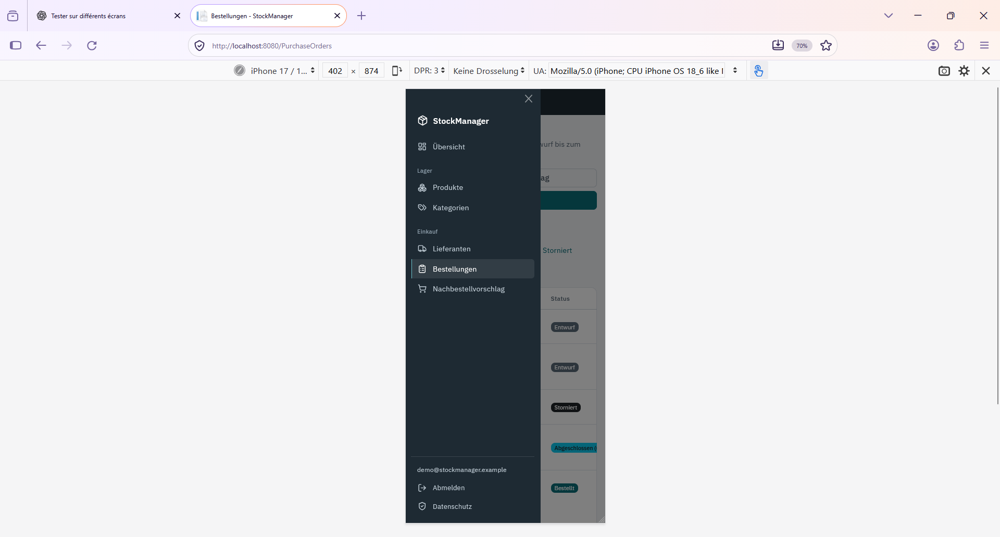

# StockManager

**Lagerverwaltung für kleine Betriebe:** Produkte, Lieferanten, Bestellungen, Wareneingang und Nachbestellvorschlag in einer Webanwendung.




## Warum dieses Projekt?

StockManager ist mein Lern- und Portfolioprojekt: eine vollständige, realistische Geschäftsanwendung von der Datenbank bis zur Oberfläche. Vor meiner Umschulung zum Fachinformatiker für Anwendungsentwicklung habe ich in der Logistik gearbeitet (Kaufmann für Spedition und Logistikdienstleistung, Kommissionierung, Kurierfahrer). Die Abläufe kenne ich aus der Praxis: Wareneingang, Mindestbestand, Nachbestellung.

## Funktionen

- **Produkte und Kategorien:** Suche, Seitenaufteilung, Filter „Unter Mindestbestand“, Standardlieferant je Produkt, Archivieren statt Löschen (nicht möglich, solange das Produkt in einer offenen Bestellung steht).
- **Lagerbewegungen:** Wareneingang, Warenausgang und Inventurkorrektur mit lückenloser Historie. Der Bestand kann nie negativ werden.
- **Lieferanten:** Stammdaten, Archiv mit Wiederherstellung.
- **Bestellungen:** Entwurf, bestellt, teilweise geliefert, geliefert, storniert oder (unvollständig) abgeschlossen. Positionen werden im Entwurf bearbeitet.
- **Wareneingang:** Teillieferungen werden in einer einzigen Transaktion gebucht und verändern Bestand, Bestellung und Historie gemeinsam.
- **Nachbestellvorschlag:** Schlägt vor, was bestellt werden soll, damit der Bestand wieder über dem Mindestbestand liegt. Bereits bestellte oder geplante Mengen werden berücksichtigt, die Vorschläge sind nach Standardlieferant gruppiert, und per Klick entstehen die Bestellentwürfe.
- **Übersicht:** Kennzahlen, kritische Bestände mit Bestandsanzeige, letzte Bewegungen.
- **Anmeldung:** ASP.NET Core Identity, Passwortregeln, Sperre nach fünf Fehlversuchen.
- **Oberfläche:** durchgehend deutsch, responsiv (Seitenleiste am Desktop, Menü auf dem Smartphone).

## Screenshots

| | |
|---|---|
|  |  |
|  |  |

<p align="center">
  
</p>

## Technik

| Bereich | Eingesetzt |
|---|---|
| Anwendung | ASP.NET Core MVC (.NET 10), C# |
| Daten | Entity Framework Core 10, SQL Server, Migrationen |
| Anmeldung | ASP.NET Core Identity |
| Oberfläche | Razor Views, Bootstrap 5.3 mit eigenem Design, IBM Plex Sans und Lucide-Icons lokal eingebunden |
| Tests | xUnit mit SQLite im Arbeitsspeicher (145 Tests) |
| Betrieb | Docker und Docker Compose (mit SQL Server), GitHub Actions |

## Wichtige Entwurfsentscheidungen

- **Geschäftsregeln im Service, nicht im Controller.** Controller und Views bleiben dünn; die Regeln liegen in Services und werden dort getestet.
- **Doppelt abgesichert.** Der Bestand darf nie negativ werden: Der Service prüft es, zusätzlich verhindert es eine CHECK-Bedingung in der Datenbank. Ebenso eindeutig ist die Referenz aktiver Produkte (gefilterter eindeutiger Index).
- **Optimistische Nebenläufigkeit** (`RowVersion`) bei Produkt und Bestellung; zwei gleichzeitige Buchungen überschreiben sich nicht stillschweigend.
- **Archivieren statt Löschen**, mit klaren Regeln: Ein Lieferant oder Produkt in einer offenen Bestellung lässt sich nicht archivieren.
- **Deutsche Dezimalschreibweise** über einen eigenen Model Binder (`12,5` wird akzeptiert, `12.5` wird abgelehnt).
- **Demodaten laufen durch dieselben Services** wie die Anwendung selbst, die Regeln gelten also auch dort. Ein Test prüft ihre Konsistenz.
- **Kein Geheimnis im Repository.** Zugangsdaten kommen aus Benutzergeheimnissen oder Umgebungsvariablen. Schrift und Icons werden vom eigenen Server geladen, es gibt keine Drittanbieter-Ressourcen.

## Schnellstart

### Mit Docker (empfohlen)

Voraussetzung: Docker Desktop (Windows, macOS oder Linux). Eine Installation von .NET oder SQL Server ist nicht nötig.

```bash
git clone https://github.com/slimboudjedra/StockManager.git
cd StockManager
docker compose up --build -d
```

Danach <http://localhost:8080> öffnen und mit dem Demo-Konto anmelden: `demo@stockmanager.example` / `Demo-Lager-2026!`. Beim ersten Start legt die Anwendung die Datenbank an und füllt sie mit fiktiven Beispieldaten.

Beenden: `docker compose down` (mit `-v` wird auch die Datenbank gelöscht).

**Hinweise**

- **Erster Start:** Er dauert einige Minuten, weil etwa 2 GB heruntergeladen werden (SQL Server und .NET). Spätere Starts dauern Sekunden. Den Fortschritt zeigt `docker compose logs web`.
- **Apple Silicon (M1 bis M4):** Das SQL-Server-Image ist für x86 gebaut. In Docker Desktop unter *Settings, General* die Option „Use Rosetta for x86_64/amd64 emulation on Apple Silicon“ aktivieren. Startet der Container `db` nicht, liegt es meist daran.
- **Port 8080 belegt:** In `docker-compose.yml` die Zeile `127.0.0.1:8080:8080` ändern, zum Beispiel auf `127.0.0.1:8081:8080`, und dann <http://localhost:8081> öffnen.
- **Eigene Passwörter:** `.env.example` nach `.env` kopieren und die Werte anpassen. Ohne `.env` gelten die öffentlichen Demo-Werte.
- **Die Anwendung ist nur von diesem Rechner aus erreichbar** (`127.0.0.1`), die Datenbank gar nicht von außen.
### Ohne Docker (.NET 10 SDK und SQL Server LocalDB)

```powershell
$env:Database__MigrateOnStartup = "true"
$env:Seed__DemoData = "true"
$env:Seed__AdminEmail = "demo@stockmanager.example"
$env:Seed__AdminPassword = "Demo-Lager-2026!"
dotnet run --project StockManager
```

Die Voreinstellung verbindet sich mit LocalDB (nur Windows). Für einen anderen SQL Server die Verbindung über `ConnectionStrings__DefaultConnection` setzen.

## Konfiguration

| Schlüssel (Umgebungsvariable mit `__`) | Bedeutung | Voreinstellung |
|---|---|---|
| `ConnectionStrings:DefaultConnection` | Verbindung zu SQL Server | LocalDB |
| `Database:MigrateOnStartup` | Datenbank beim Start anlegen und auf den neuesten Stand bringen | `false` |
| `Seed:DemoData` | Fiktive Beispieldaten anlegen (nur in einer Datenbank ohne Fachdaten) | `false` |
| `Seed:AdminEmail`, `Seed:AdminPassword` | Konto des Administrators, wird beim Start angelegt, falls es fehlt | nicht gesetzt |
| `Hosting:DisableHttpsRedirection` | HTTPS-Umleitung abschalten (z. B. im Container) | `false` |

Die Demo-Zugangsdaten sind öffentlich bekannt. Sie gehören nur in eine lokale Demo, nie in eine Installation, die von außen erreichbar ist.

## Tests

```bash
dotnet test StockManager.Tests/StockManager.Tests.csproj
```

Die Tests laufen mit SQLite im Arbeitsspeicher. Die Nebenläufigkeitsprüfung (`RowVersion`) lässt sich dort nicht abbilden und ist nur gegen SQL Server testbar.

## Projektstruktur

```text
StockManager/              Webanwendung
  Controllers/             Eingabe und Ausgabe
  Services/                Geschäftsregeln
  Models/                  Entitäten
  ViewModels/              Datenmodelle der Seiten
  ModelBinders/            Deutsche Dezimalschreibweise
  Data/                    DbContext, Anmelde-Seeder
  Migrations/              Datenbankschema
  Views/                   Razor-Seiten
  wwwroot/                 Stile, Schrift, Icons
StockManager.Tests/        xUnit-Tests
docs/screenshots/          Bilder für dieses README
```

## Bekannte Grenzen und nächste Schritte

- Benutzerrollen (Administrator, Mitarbeiter) und ein Protokoll, wer was gebucht hat.
- Archivierte Produkte in der Oberfläche wiederherstellen.
- Sollbestand je Produkt für den Nachbestellvorschlag (derzeit fest das Doppelte des Mindestbestands).
- Tests für Produkt- und Kategoriedienst ergänzen.
- Die Oberfläche ist bisher nur auf Deutsch.

## Hinweis zu den Daten

Alle Beispieldaten sind frei erfunden. E-Mail-Adressen enden auf `.example`, einer Domain, die es nicht gibt.

## Lizenz

MIT, siehe [LICENSE](LICENSE).

## Autor

**Slim Boudjedra**, Fachinformatiker für Anwendungsentwicklung (IHK), Dortmund. [GitHub-Profil](https://github.com/slimboudjedra)